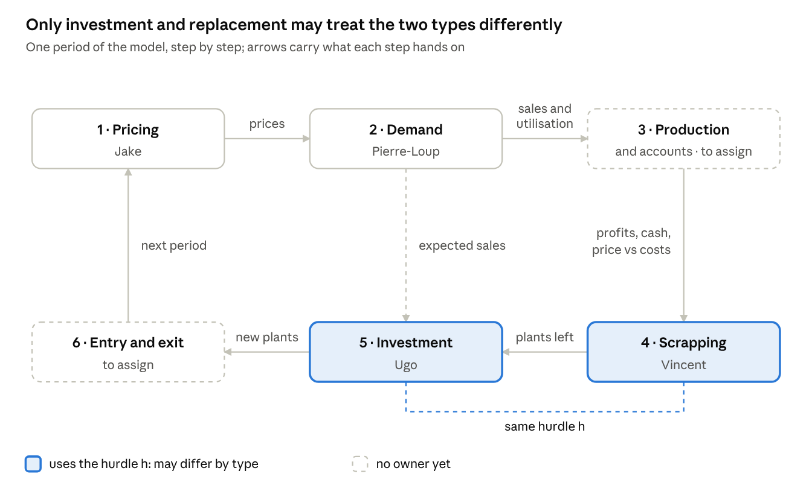

# ABM mechanism briefs

Each of you designs one mechanism before the next meeting. Each brief says what the mechanism decides, the trap that would settle the Shaikh–Okishio contest by construction, the questions to answer, a starting rule, tests and readings. The shared ground comes first, so that the six pieces plug together.

## Shared ground

Agree on four things before anyone codes: one notation, one order of events, one test industry and one format for what you bring.

**One rule binds all six mechanisms: stay neutral between the two types of firm.** Shaikh firms and Okishio firms differ only in the hurdle h they use to choose techniques, in investment, replacement and entry. Pricing, demand, production and accounts, physical scrapping and exit must treat both types the same. For each rule you write, ask whether it hands one type an advantage by construction.

**Notation.** The money wage is the numéraire (w = 1), so costs and prices are in wage units.

| Symbol   | Python name | Meaning                                                                                  | Set by                  |
|----------|-------------|------------------------------------------------------------------------------------------|-------------------------|
| p_i      | price       | posted price of firm i                                                                   | Pricing                 |
| D_t      | demand      | industry demand, units per period                                                        | exogenous               |
| f_i      | share       | market share (part de marché)                                                            | Demand                  |
| x_i      | sales       | units sold, equal to output (no inventory in version 1)                                  | Demand                  |
| q̄\_i     | capacity    | normal output of the firm’s plants; output can stretch to u_max·q̄\_i (say 1.2)           | Investment, Scrapping   |
| u_i      | util        | utilisation x_i / q̄\_i, equal to 1 at normal output                                      | Demand                  |
| ucs_v    | ucs         | unit operating cost of plant v (wages, materials)                                        | plant                   |
| κ_v      | kappa       | capital per unit of normal output                                                        | plant                   |
| δ        | delta       | depreciation rate, 1/T for a life of T periods                                           | parameter               |
| uc_v     | uc          | unit cost, ucs_v + δ·κ_v                                                                 | derived                 |
| h_i      | hurdle      | 0 for Shaikh firms; the best profit rate on offer at the current price for Okishio firms | type                    |
| r̄        | rbar        | general rate of profit, set outside the industry                                         | parameter               |
| M_i, B_i | cash, debt  | balance sheet                                                                            | Production and accounts |
| Π_i      | profit      | profit after depreciation and interest                                                   | Production and accounts |
| NW_i     | net_worth   | cash plus book value of plants, minus debt                                               | Production and accounts |
| ρ        | rho         | interest rate on debt                                                                    | parameter               |
| r^new    | r_new       | profit rate on plants built in the last k periods                                        | Entry and exit          |

**Order of events (a proposal).** Each step sees only what earlier steps produced:

1.  Pricing: firms post p_i from last period’s prices and utilisation.
2.  Demand: shares from prices, demand allocated within capacity, sales and utilisation.
3.  Production and accounting: plants run in merit order, lowest operating cost first; profits and cash.
4.  Scrapping: plants leave by age or obsolescence; replacement decisions.
5.  Investment: expected demand, desired capacity, technique chosen with h, finance. New plants arrive next period.
6.  Entry and exit, then the collector.

**The test industry: Shaikh’s three plants.** Everyone tests on the same three firms (Shaikh 2016, Tables 7.10–7.11), with δ = 10 % and r̄ = 16 %:

| Firm | Normal output | Capital stock | κ      | uc  | ucs   | Profit rate at p = 100 |
|------|---------------|---------------|--------|-----|-------|------------------------|
| C    | 120           | 16,500        | 137.50 | 78  | 64.25 | 16.00 %                |
| D1   | 130           | 18,500        | 142.31 | 76  | 61.77 | 16.86 %                |
| D2   | 133           | 21,000        | 157.89 | 75  | 59.21 | 15.83 %                |

D2 is the case that matters: the lowest unit cost, but the lowest profit rate at the going price. Total normal output is 383; set demand below it, say 340, to create the excess capacity that starts price wars (guerres des prix).

**What to bring: a two-page mechanism card.**

1.  The question the mechanism answers in the model, in one sentence.
2.  The theory chosen and the alternatives rejected, with references.
3.  The equations, with default parameter values and ranges.
4.  What it reads and writes, in the notation above.
5.  The bias check: can it favour one type by construction, and how would we see it?
6.  One Python file in the course template (equations/ or markets/), at least two unit tests, and a run on the test industry with the other mechanisms stubbed.
7.  Open questions for the group.

**Not owned yet: production and accounts, entry and exit.** Their briefs follow, in the order of events, and get an owner at the meeting. Until then, note what your mechanism reads from or writes to cash, debt and net worth.

## Pricing — Jake

Pricing is where real competition (concurrence réelle) happens: the low-cost firm cuts its price, followers match, and cuts stop at operating cost (Shaikh 2016, Table 7.3). Your rule decides whether a cheaper but more capital-intensive firm can ever use its cost advantage.

**The trap: the anchor price decides the winner.** Firms need a normal price to return to between price wars. The two standard anchors give opposite verdicts on Shaikh’s D2:

| Anchor                                             | Formula                     | C   | D2     | Cheaper in normal times                     |
|----------------------------------------------------|-----------------------------|-----|--------|---------------------------------------------|
| Markup on unit cost                                | (1 + μ)·uc, with μ = 28.2 % | 100 | 96.15  | D2: the unit-cost rule wins by construction |
| Target return on capital (taux de rendement cible) | uc + r̄·κ                    | 100 | 100.26 | C: D2 can win only through price wars       |

The course’s reference model, K+S, puts its markup on operating cost (Dosi & Roventini 2025, eq. 11), which tilts further toward D2 (92.2). Choose the anchor knowingly; if time allows, run both, because the comparison is itself a result.

**Questions to answer**

1.  **Anchor.** What price does a firm aim for in normal times? Start with target return at normal utilisation, p^N_i = uc_i + r̄·κ_i, the firm’s own price of production. Keep markup pricing as the alternative.
2.  **Leader.** Who leads? Let the leader be last period’s lowest posted price, so that leadership emerges. Defining the leader as the lowest-cost firm would assume row 3 of Table 7.3 instead of producing it.
3.  **Band.** How far above the leader can a firm stay? A band b of 2–3 % produces correlated, not identical, prices.
4.  **Price war.** What starts a cut, how deep, when does it stop? Cut by c per period (say 2 %) after T periods (say 2) below a utilisation threshold. Never jump straight to the floor.
5.  **Floor.** Which cost? The unit operating cost ucs of the most expensive plant the firm needs to run, not the full unit cost: depreciation is sunk in the short run (Shaikh 2016, p. 316).
6.  **Recovery.** How do prices climb back after a war? Without a way up, prices ratchet down and profit rates fall by construction: the main flaw of the 16 October draft.

**Starting rule**

$$
p_{i,t} = \max\{\, ucs_i,\ \tilde p_{i,t} \,\}, \qquad
\tilde p_{i,t} =
\begin{cases}
(1-c)\, p_{i,t-1} & \text{if } u_{i,t-k} < u^{war} \text{ for } k = 1,\dots,T \\
\min\{\, p_{i,t-1} + \lambda\,(p^{N}_i - p_{i,t-1}),\ (1+b)\, p^{lead}_{t-1} \,\} & \text{otherwise}
\end{cases}
$$

In normal times a firm moves toward its anchor at speed λ but stays within b of the leader. In a war it cuts by c per period, down to its floor.

**Tests:** (1) no price below ucs_i; (2) identical firms with demand at normal capacity keep their anchor price; (3) on the test industry with demand at 340, a war starts, deepens, ends, and prices recover; (4) swapping the type labels changes nothing.

**Collect:** dispersion of prices against dispersion of unit costs (the law of correlated prices, loi des prix corrélés); whether the leader is the lowest-cost firm; margins p − uc; number, depth and length of price wars.

**Coordinate with** Pierre-Loup (how fast a price gap moves shares), Vincent (which plant sets the floor) and Ugo (new capacity is what starts wars).

**Read:** Shaikh (2016), Table 7.3, p. 271, pp. 272–290 and pp. 313–317; Dosi & Roventini (2025), p. 39, eqs 11–12 (K+S markup, which rises with market share); Seppecher, Salle & Lavoie (2018), markups that mutate and are copied; White (2025), target-return pricing in a Sraffian gravitation model.

## Demand as a quasi-replicator of price — Pierre-Loup

Demand allocation is the selection environment: it sets how fast a price advantage becomes market share, and so whether a price war pays. The selection intensity (intensité de sélection) χ may be the most important parameter of the project.

**The trap: χ picks the winner.** With strong selection, a small price cut moves customers fast, price wars pay, and the unit-cost rule gains. With weak selection, shares barely move, and the firms with higher profit rates win by accumulating faster. Selection is weak in the data: relative productivity explains little of firm growth (Dosi et al. 2015), and markets select on profitability rather than productivity (Foster, Haltiwanger & Syverson 2008). Report results at weak selection too, not only where Shaikh’s mechanism shines.

**A second trap, in the course formula.** K+S defines competitiveness as negative, E_j = −ω₁·p_j − ω₂·l_j, then updates shares by χ·(E_j − Ē)/Ē (Dosi & Roventini 2025, eqs 13–14). With Ē negative the ratio flips sign: copied literally, the update sends customers to the dearer firm. Divide by \|Ē\|, or use a positive competitiveness such as 1/p_j.

**Questions to answer**

1.  **Competitiveness.** Price only, or price and unfilled demand (delivery reliability)? Start with price only; add unfilled demand once capacity limits bind.
2.  **Functional form.** The course’s linear quasi-replicator, or a logit form with shares proportional to p^(−η)? The logit form never produces negative shares.
3.  **Negative shares.** With a large χ the update can push a share below zero. K+S then declares the firm dead and renormalises (Dosi & Roventini 2025, n. 44). That makes your rule an exit rule too, so tell the group which threshold you use.
4.  **Capacity.** When a firm’s share of demand exceeds its capacity, it sells its capacity and the overflow goes to the cheapest firms with spare capacity. Record the unmet demand l_i: it can enter competitiveness next period.
5.  **Industry demand.** A fixed quantity, a growth path D₀·(1 + g)^t, shocks of size σ (the volatility treatment)? Start insensitive to the industry price: price wars then only move customers between firms.
6.  **Entrants.** What share does a new firm start with: in proportion to its capacity, or a small fixed share?

**Starting rule**

$$
E_{i,t} = \frac{1}{p_{i,t}}, \qquad \bar E_t = \sum_j f_{j,t-1}\, E_{j,t}, \qquad f_{i,t} = f_{i,t-1}\left(1 + \chi\, \frac{E_{i,t} - \bar E_t}{\bar E_t}\right)
$$

Then sales are x_i,t = min{f_i,t·D_t, u_max·q̄\_i} with the overflow passed on, and utilisation is u_i,t = x_i,t / q̄\_i. To make χ readable: at χ = 1, a small firm 2 % cheaper than average grows its share by about 2 % a period, doubling it in about 35 periods.

**Tests:** (1) shares stay non-negative and sum to one; (2) equal prices leave shares unchanged; (3) a firm 2 % cheaper gains share at the rate χ predicts; (4) demand beyond capacity goes to others and no unit is sold twice; (5) swapping the type labels changes nothing.

**Collect:** shares, sales and utilisation (Jake’s war trigger and Ugo’s investment both need it), unmet demand, concentration (Herfindahl index), and the slope of share growth on relative price.

**Coordinate with** Jake (prices in, utilisation out) and Ugo (expected demand for investment).

**Read:** Silverberg, Dosi & Orsenigo (1988), the original replicator with vintages and diffusion; Dosi & Roventini (2025), p. 40, eqs 13–14 and n. 44; Kirman & Vriend (2001), buyer loyalty and price dispersion, for the loyalty treatment; Foster, Haltiwanger & Syverson (2008) and Dosi et al. (2015), on how strong selection is in data.

## Production and accounts — to assign

Production and accounts turn sales into output, costs, profits and balance sheets. Every other mechanism reads them: Jake’s floor and Vincent’s retirement read operating costs, Ugo’s investment reads cash and debt, and entry and exit read profit rates and net worth (valeur nette). This is also where the model checks its stock-flow consistency (cohérence stock-flux).

**The trap: the accounts define the profit rate that every rule compares.** The hurdle, the retirement test, the entry trigger and the collectors all set a profit rate against r̄ or against another rate. If the accounts report profit gross of depreciation, as K+S does (Dosi & Roventini 2025, p. 40), every rate sits δ above the net rate r = (p − uc)/κ that r̄ measures: an entry trigger then lets capital in until the net rate falls to 6 % on the test industry, not 16 %. If they divide by book value, an old plant’s rate climbs without limit as its book value falls to zero, and the oldest plants look like the best. Use one definition everywhere: profit net of depreciation and interest, over capital at purchase cost. Book values serve only for net worth.

**Questions to answer**

1.  **Output.** Produce to order, so that output equals sales up to capacity? Or to expected demand, as K+S does, with unsold output piling up as inventories (p. 38, eq. 8, and p. 40, n. 43)? Start with production to order: an inventory cycle would also trip Jake’s utilisation trigger.
2.  **Beyond normal capacity.** What does output above q̄\_i cost? Shaikh defines economic capacity as the lowest point of the average total cost curve (2016, p. 262), so stretching to u_max·q̄\_i should raise unit operating cost. Start with a premium on output above q̄\_i, the same for both types.
3.  **Timing of payments.** Are wages paid before sales? If so, firms need cash or credit to produce: K+S firms pay for production out of liquid assets first, then borrow up to a cap on debt relative to sales (p. 39). This is Ugo’s capital advanced τ, seen from the cash account.
4.  **Interest and dividends.** One interest rate ρ on debt, below r̄: the profit rate of enterprise, r − i in Shaikh’s notation, must be positive for firms to be viable (2016, p. 447). Seppecher, Salle & Lavoie (2018) retain a constant fraction of past net profits and pay out the rest. Use one payout rule for both types: dividends drain the internal funds that drive accumulation.
5.  **Valuation and write-offs.** Book value at historical cost, straight line over T periods. A plant Vincent retires early leaves its remaining book value as a write-off, which lowers net worth while no cash moves. Add a collector at replacement cost.
6.  **Closure.** Where do wages, materials, plant purchases, interest and dividends go, and where does demand come from? Book them all to one rest-of-economy account. Money is then conserved, and the stock-flow check can run every period, as the course asks.

**Starting rule**

$$
\begin{aligned}
\Pi_{i,t} &= (p_{i,t} - ucs_i)\,x_{i,t} - \delta\,\kappa_i\,\bar q_i - \rho\,B_{i,t-1}, \qquad r_{i,t} = \frac{\Pi_{i,t}}{\kappa_i\,\bar q_i} \\
M_{i,t} &= M_{i,t-1} + \Pi_{i,t} + \delta\,\kappa_i\,\bar q_i - \mathit{Div}_{i,t} - \kappa_{j^*}\,I_{i,t} + \Delta B_{i,t} \\
NW_{i,t} &= M_{i,t} + K^{b}_{i,t} - B_{i,t}
\end{aligned}
$$

Depreciation is a cost but not a payment, so the cash account adds it back. Cash then pays for new plants, Vincent’s replacements included, and new borrowing ΔB_i,t covers any gap up to the cap. Dividends are Div_i,t = d·max{0, Π_i,t}, with the same payout d for both types (say 0.5). K^b_i,t is the book value of the firm’s plants. With output at q̄\_i and no debt, r_i,t reduces to (p − uc)/κ, the rate Ugo’s rule uses.

**Tests:** (1) at normal output with no debt, r_i equals (p − uc)/κ: 16.00 % for C, 16.86 % for D1 and 15.83 % for D2 at p = 100; (2) for every firm and period, the change in net worth equals profit minus dividends minus write-offs; (3) with the rest-of-economy account as a sector, every row and column of the transaction-flow matrix sums to zero (Caiani et al. 2016, p. 382); (4) a plant’s depreciation charges add up to its purchase cost, and its book value is zero at age T; (5) a firm without sales loses exactly depreciation plus interest; (6) swapping the type labels changes nothing.

**Collect:** output, utilisation and unit cost by firm; profits, margins p − uc and three profit rates (average over plants, on the newest plant, and the incremental rate ΔP_t/I_t−1 of Shaikh 2016, eq. 7.7), at historical and at replacement cost; cash, debt, net worth and leverage; dividends, write-offs and the transaction-flow matrix each period.

**Coordinate with** Jake (prices in, margins out; the floor is ucs), Pierre-Loup (sales and utilisation in), Vincent (book values and write-offs at early retirement), Ugo (cash and borrowing capacity; whether wages are advanced) and whoever takes entry and exit (net worth and profit rates trigger exit and entry).

**Read:** Shaikh (2016), p. 316, for ucs, κ, depreciation δκ and uc = ucs + δκ, and p. 447 on r − i; Dosi & Roventini (2025), p. 38, eq. 8, p. 39 and p. 40, on production, its finance, profits and liquid assets; Caiani et al. (2016), p. 382, on the balance-sheet and transaction-flow matrices of an agent-based stock-flow consistent model; Seppecher, Salle & Lavoie (2018), on retained profits and dividends.

## Scrapping — Vincent

Scrapping (déclassement) decides how long old plants survive. It sets the spread of vintages (millésimes) behind unequal margins, the speed at which a new technique spreads, and which plant sets the floor of a price war.

**Three decisions, not one.** Keep them apart in the code:

1.  **Run or idle** (short run). A plant runs only if its output is needed and the price covers its operating cost; plants run in merit order. This is production, not scrapping.
2.  **Retire.** A plant leaves for good at its maximum age T, or once the price has stayed below its operating cost for N periods: its quasi-rent is negative (Salter 1966).
3.  **Replace.** A working plant is scrapped because a new technique is cheap enough to justify the new capital. This is where the two types of firm differ.

**The trap: replacement is a second choice of technique.** With the hurdle h, replacing plant v by technique n pays when:

$$
ucs_v > ucs_n + (\delta + h)\,\kappa_n
$$

Shaikh firms (h = 0) replace earlier, which gives them younger capital, a narrower spread of vintages and faster diffusion. Okishio firms keep old plants longer. So retirement must be identical for both types, and only replacement may use h, the same h as Ugo’s investment. Leaving replacement out removes one channel of the contest: decide it explicitly. K+S replaces a machine when its price over the cost saving is at most b = 3 periods, and scraps machines older than η (Dosi & Roventini 2025, p. 38, eq. 10). Read 1/b as δ + h: with b = 3, K+S sits on the profit-rate side.

**Questions to answer**

1.  **Plant structure.** One plant per firm, or a list of vintages? With one plant, retirement means exit or rebuilding; with a list, capacity and costs change plant by plant. Decide with Ugo.
2.  **Depreciation.** Accounting only (straight line, δ = 1/T), or physical too, with capacity or productivity falling with age? The draft’s “capital depreciation changing unit cost” mixes the two. Start with accounting only and a fixed life T.
3.  **Obsolescence trigger.** Price below operating cost for N periods, or a plant idle for N periods? Choose N (say 3–5) so that one price war does not wipe out plants that would earn again afterwards.
4.  **Write-off.** A plant retired early leaves book value behind: a capital loss that lowers net worth and can trigger bankruptcy. Say who should record it.
5.  **Scrap value.** Zero to start (capital is sunk), or a second-hand price?
6.  **Replacement in version 1?** Or retirement by age and obsolescence only? The answer changes what the contest measures.

**Tests:** (1) a plant reaching age T leaves; (2) a plant whose ucs stays above the price for N periods leaves; (3) an old plant with ucs = 80, facing a new technique with ucs = 60 and κ = 150 at δ = 10 %: a Shaikh firm replaces it (75 \< 80), an Okishio firm at h = 16 % keeps it (99 \> 80); (4) on the test industry, no working plant is replaced under either rule, since C’s operating cost (64.25) is below D2’s unit cost (75): D2 enters as new capacity; (5) capacity after scrapping equals capacity before minus retired plants.

**Collect:** age distribution of plants; spread between best and worst plant; each technique’s share of capacity over time (its diffusion curve); capacity retired per period. Targets from data: in cement, the best 1930s plant produced about 3.5 times as much per hour as the worst (Salter 1966, p. 96; Shaikh 2016, p. 285); US precalciner kilns went from 0 in 1973 to 24 in 1983 and 66 in 2013 (Macher, Miller & Osborne 2021, p. 81).

**Coordinate with** Ugo (the same h; replacement is investment too) and Jake (the marginal plant sets the price floor, and prices drive obsolescence).

**Read:** Salter (1966), plants as “a fossilised history of technology” (p. 52, quoted in Shaikh 2016, p. 284); Shaikh (2016), pp. 284–290; Dosi & Roventini (2025), p. 38, eq. 10; the critique of the proposal (17 October 2026, kept in Ugo's notes), §5, on the replacement margin with cement numbers.

## Investment — Ugo

Investment carries the rule under test. It makes three decisions: how much capacity to add, which technique the new plants embody, and how to pay for them. Only the second may differ between the two types.

**The trap: the quantity and finance rules can settle the contest before the technique rule does.** If firms invest all their cash, as the 16 October draft says (“once they paid for costs”), capacity grows with profits. The firms with the higher profit rate at the going price, the Okishio firms, then grow faster. Investment also creates the excess capacity that starts Jake’s price wars, which favour Shaikh firms. The volume rule therefore sets the balance between the two selection channels.

**Questions to answer**

1.  **How much.** Desired capacity from expected sales (K+S: expansion investment equals desired minus current capital, Dosi & Roventini 2025, p. 38, eq. 9)? Accumulation out of profits (classical)? Or the gap between actual and normal utilisation, with hysteresis (Bassi & Lang 2016; Bassi et al. 2022)? Start with the first, identical for both types.
2.  **Expectations.** K+S often uses last period’s demand (p. 38, n. 37). Start there; add a trend g if demand grows.
3.  **Which technique.** The hurdle rule below, with h = 0 for Shaikh firms and h = the best profit rate on offer for Okishio firms. At which price do Okishio firms evaluate: the industry average, the leader’s, or their own? Decide and write it down.
4.  **Capital advanced (capital avancé).** Are wages advanced? K+S firms do advance them (p. 39). With Shaikh’s numbers, D2 stops being a conflict case once more than about 12 % of a period’s operating cost counts as capital: τ decides whether the two rules ever disagree.
5.  **Lumps and lags.** Plants of fixed size (Shaikh’s 120–133) or continuous capacity? New plants arrive next period (K+S, p. 35), and K+S caps capacity growth per period (n. 38).
6.  **Finance.** Cash first, then debt up to a cap; K+S caps debt relative to sales (p. 39). The same rule for both types, with easier credit as a treatment. K+S gives expansion priority over replacement when funds are short (n. 41).
7.  **Menu.** Shaikh’s C, D1 and D2 first. Later, random draws of (Δucs, Δκ) by direction and size, reporting the share that falls where the two rules disagree: about 5 % with neutral directions.

**Starting rule**

$$
\bar q^{\,d}_{i,t} = (1+g)\, x_{i,t-1}, \qquad I_{i,t} = \max\{0,\ \bar q^{\,d}_{i,t} - \bar q_{i,t}\}, \qquad j^{*} = \arg\min_{j}\, \big[(1 + h_i\tau)\, ucs_j + (\delta + h_i)\, \kappa_j\big]
$$

The new capacity I_i,t, plus Vincent’s replacements, is built with technique j\* and paid from cash, then debt. With h = 0 the rule picks the lowest unit cost; with h equal to the best profit rate at the current price, it picks the highest profit rate.

**Tests:** (1) on Shaikh’s menu at p = 100, Shaikh firms build D2 (unit cost 75) and Okishio firms D1 (16.86 %); with only C and D2 on offer, Okishio firms keep C; (2) on random menus, the argmin with h equal to the best profit rate picks the same technique as maximising the profit rate directly; (3) with constant demand and no scrapping, investment falls to zero once capacity meets expected sales; (4) debt never exceeds its cap; (5) two firms of different types with the same sales invest the same amount.

**Collect:** investment and technique choices by type; the rate of profit on the newest plant and the incremental rate ΔP_t/I_t−1 (Shaikh 2016, eq. 7.7), which will drive entry; each type’s capacity growth split into investment, retirement and exit.

**Coordinate with** Vincent (the same h for replacement), Pierre-Loup (expected sales) and Jake (new capacity is what starts wars).

**Read:** Michl (2023), the two adoption rules and when they conflict; Shaikh (2016), pp. 313–321; Dosi & Roventini (2025), pp. 37–39, eqs 6–10; Bassi & Lang (2016), an agent-based Kaleckian investment function with hysteresis by one of the course’s teachers.

## Entry and exit — to assign

Entry and exit move capital between the industry and the rest of the economy, and they decide which rule the population carries in the long run. For Shaikh, the entry and exit of capital “serve to equalize profit rates on new investment” (2016, p. 264). Entry is decisive here: no price lets D2 earn the normal rate and keep C out (critique of the proposal, 17 October 2026, §3).

**The trap: entry is a third choice of technique.** An entrant decides whether to come in and which plant to build. If all entrants follow one rule, as the draft’s “best rate of profit at current wage, technologies and price” does, the contest is settled by construction. If each candidate decides with its own rule at the current price, Shaikh’s menu lets Okishio entrants in (D1 earns 16.86 % at p = 100) and keeps Shaikh entrants out (D2 earns 15.83 %, below r̄ = 16 %). Keep the two decisions apart: a trigger both types share, then a rule the entrant inherits and uses to pick its plant. Exit has its own trap: if capital leaves only through bankruptcy, as in the draft, a firm earning 5 % against r̄ = 16 % stays as long as its net worth is positive, and capital moves in one direction only.

**Questions to answer**

1.  **Trigger.** Which rate, against r̄? Start with the realised profit rate on plants built in the last k periods: entry equalises the rate on new investment, not the average over all vintages (Shaikh 2016, p. 264). It is an industry signal, the same for every candidate.
2.  **Flow.** How many entrants per period? Start with at most one, with a probability that rises with the gap between the trigger rate and r̄; its plant arrives next period, like Ugo’s. Where entry needs a large initial investment, entry and exit are sticky, and incumbents absorb fluctuations through utilisation instead (Shaikh 2016, p. 270).
3.  **Inherited rule.** Copy the hurdle h of an incumbent drawn by market share, with a small mutation rate m. Seppecher, Salle & Lavoie (2018) give a bankrupt firm the strategies of a surviving firm drawn at random. For the invasion experiment, send a set share of entrants to the other rule.
4.  **Plant, size and price.** The entrant picks its technique on the menu with its own h, through Ugo’s formula. K+S entrants are smaller than incumbents: their capital and liquid assets are random fractions of the incumbents’ averages (Dosi & Roventini 2025, p. 41). Entrants tend to undercut incumbents (Geroski, cited in Shaikh 2016, p. 282): start a little below the leader’s price, with a market share in proportion to capacity (Pierre-Loup’s question 6).
5.  **Exit.** Three channels, the same for both types: bankruptcy (faillite) when net worth turns negative; a market share near zero, as in K+S (p. 41); and non-renewal, when a firm whose plant retires earned less than r̄ over the plant’s life and does not rebuild. With several plants per firm, Harrod’s distinction applies: incumbents “enter” by adding plants and “exit” by scrapping them (Shaikh 2016, p. 281).
6.  **Population and money.** Open, with entry and exit set apart, or fixed, with each dead firm replaced, as in K+S (p. 41) and Seppecher et al.? A fixed population is simpler but cuts the link from profitability to entry, which is Shaikh’s mechanism: start open, with a floor of two firms. Either way, an entrant’s plant and cash come from the rest-of-economy account, and a bankrupt firm’s unpaid debt is a loss there.

**Starting rule**

$$
\Pr(\text{entry}_t) = \min\left\{1,\ \theta\,\frac{\max(0,\ r^{new}_t - \bar r)}{\bar r}\right\}, \qquad h_e = h_j \ \text{ with } \Pr(j) = f_{j,t}, \qquad \text{exit if } NW_{i,t} < 0 \ \text{ or } f_{i,t} < f_{\min}
$$

r^new_t is the average profit rate, at the current price, of plants built in the last k periods (say 5). θ sets the speed of entry (say 5: a trigger one point above r̄ = 16 % gives a 31 % chance a period). The entrant’s h mutates with probability m (say 2 %), its capacity is a fraction φ of the average incumbent’s (say 0.5), and it builds the technique its own rule picks. A firm whose plant retires also leaves if its profit rate over the plant’s life fell short of r̄.

**Tests:** (1) with r^new at or below r̄ throughout, no firm enters; (2) a firm whose net worth turns negative leaves at the end of the period, its customers are shared out, and shares still sum to one; (3) over many draws, entrants’ rules match incumbents’ market shares, up to the mutation rate; (4) on the test industry at p = 100, an Okishio entrant builds D1 and a Shaikh entrant D2, on the same trigger; (5) capacity after entry and exit equals capacity before, plus entrants’, minus leavers’, and money is conserved when an entrant brings cash or a bankrupt firm defaults; (6) swapping the type labels changes nothing.

**Collect:** entries and exits per period, and how they move together; the age at which firms leave (how many entrants die young); entrants’ rules and techniques; the number of firms and concentration; each rule’s capacity share split into incumbents’ net investment, entry and exit, the “evolutionary accounting” Dosi (2007, p. 182) calls for. Target from data: in a study quoted by Shaikh, “the most profitable industries had almost five times as many entrants as did the average industry” (2016, p. 283).

**Coordinate with** Ugo (entrants pick their plant with the investment rule and the same h), Pierre-Loup (an entrant’s starting share; shares after an exit), Jake (entry price and the leader), Vincent (non-renewal at retirement) and whoever takes production and accounts (net worth, profit rates, the cash entrants bring and the losses defaults leave).

**Read:** Shaikh (2016), pp. 264–265, on entry, exit and regulating capitals, p. 270, on sticky entry, and pp. 280–283, on Harrod’s entry and exit of plants and on entrants who undercut incumbents; Dosi & Roventini (2025), p. 35 (step 6 of the period) and p. 41 (§5.4, entry and exit in K+S); Seppecher, Salle & Lavoie (2018), on bankrupt firms that take a survivor’s strategies; the critique of the proposal (17 October 2026, kept in Ugo's notes), §3 (why entry is decisive) and §6 (the invasion experiment and the decomposition).

## How the pieces connect

*One period: six steps, four owners, one shared hurdle*

Read it clockwise: each step hands its outputs to the next, and the loop closes on next period’s prices. Only the two highlighted steps may treat Shaikh and Okishio firms differently, and they must use the same h; the dashed steps still need an owner.

## Version 2 amendments (6 November 2026, recorded 7 November)

The briefs above are the specification as exported from Claude Docs on 3 November and are
not edited. The group kept every starting rule behind a switch and changed the defaults as
follows. **Pricing:** no anchor and no war trigger; a firm follows the lowest price and
undercuts only with spare capacity and a cost edge; the floor is its own best plant's unit
cost (the group notebook's leader-follow rule, under which every firm cuts whenever
capacity is not short down to a markup floor, is the other arm of the price-war
treatment). **Accounts:** bankruptcy when cash runs out, no overdraft. **Scrapping:** plants
of S = 20, no maximum age, retirement after two periods with the price below unit cost or
two periods idle. **Investment:** all retained earnings spent on whole plants, no borrowing;
one Marx-biased design offered at each investment (an innovation set is specified as the
second arm, `review-v2.md`, section 4). **Entry:** rbar = 0.05; entrants start at the lowest
price and then price by the common rule. The order of events is unchanged; step 4 now
retires by age, obsolescence or idleness, step 5 buys from retained earnings. The test
industry runs at rbar = 5 % (the 16 % above is the version 1 value) with demand 680 and
plants of 20. Notation added: S (`PLANT_SIZE`), RE_i (`retained_earnings`), wear_v
(`wear`), a and b (a design's proportional fall in ucs and rise in κ), q (`TECH_CONFLICT`),
z and the floor markup of the leader-follow rule (`LEADER_RISE`, `FLOOR_MARKUP`).
Defaults are frozen since 7 November 2026 pending the sensitivity analysis. Details:
`choices.md`; review, decisions and plan: `review-v2.md`.

## Sources

All checked in Ugo’s Zotero on 3 November: all are in his own library. Page and equation numbers for Dosi & Roventini were read in the PDF.

- Bassi, F. & Lang, D. (2016). “Investment hysteresis and potential output: a post-Keynesian–Kaleckian agent-based approach.” *Economic Modelling*. [doi:10.1016/j.econmod.2015.06.022](https://doi.org/10.1016/j.econmod.2015.06.022)
- Bassi, F., Bauermann, T., Lang, D. & Setterfield, M. (2022). “Is capacity utilization variable in the long run? An agent-based sectoral approach to modeling hysteresis in the normal rate of capacity utilization.” *Structural Change and Economic Dynamics*. [doi:10.1016/j.strueco.2022.09.005](https://doi.org/10.1016/j.strueco.2022.09.005)
- Caiani, A., Godin, A., Caverzasi, E., Gallegati, M., Kinsella, S. & Stiglitz, J. E. (2016). “Agent based-stock flow consistent macroeconomics: towards a benchmark model.” *Journal of Economic Dynamics and Control*. [doi:10.1016/j.jedc.2016.06.001](https://doi.org/10.1016/j.jedc.2016.06.001)
- Dosi, G. (2007). “Statistical regularities in the evolution of industries: a guide through some evidence and challenges for the theory.” In F. Malerba & S. Brusoni (eds), *Perspectives on Innovation*. Cambridge University Press. [doi:10.1017/CBO9780511618390.009](https://doi.org/10.1017/CBO9780511618390.009)
- Dosi, G., Moschella, D., Pugliese, E. & Tamagni, F. (2015). “Productivity, market selection, and corporate growth: comparative evidence across US and Europe.” *Small Business Economics*. [doi:10.1007/s11187-015-9655-z](https://doi.org/10.1007/s11187-015-9655-z)
- Dosi, G. & Roventini, A. (2025). *Agent-based Macroeconomics: The Schumpeter Meeting Keynes Models*. Cambridge University Press. [doi:10.1017/9781009414173](https://doi.org/10.1017/9781009414173)
- Foster, L., Haltiwanger, J. & Syverson, C. (2008). “Reallocation, firm turnover, and efficiency: selection on productivity or profitability?” *American Economic Review*, 98(1). [doi:10.1257/aer.98.1.394](https://doi.org/10.1257/aer.98.1.394)
- Kirman, A. P. & Vriend, N. J. (2001). “Evolving market structure: an ACE model of price dispersion and loyalty.” *Journal of Economic Dynamics and Control*. [doi:10.1016/S0165-1889(00)00033-6](https://doi.org/10.1016/S0165-1889(00)00033-6)
- Macher, J. T., Miller, N. H. & Osborne, M. (2021). “Finding Mr. Schumpeter: technology adoption in the cement industry.” *RAND Journal of Economics*. [doi:10.1111/1756-2171.12362](https://doi.org/10.1111/1756-2171.12362)
- Michl, T. R. (2023). “The falling rate of profit as a research program.” *The New School Economic Review*, 12, 36–51.
- Salter, W. E. G. (1966). *Productivity and Technical Change*, 2nd ed. Cambridge University Press.
- Seppecher, P., Salle, I. L. & Lavoie, M. (2018). “What drives markups? Evolutionary pricing in an agent-based stock-flow consistent macroeconomic model.” *Industrial and Corporate Change*. [doi:10.1093/icc/dty011](https://doi.org/10.1093/icc/dty011)
- Shaikh, A. (2016). *Capitalism: Competition, Conflict, Crises*. Oxford University Press, ch. 7.
- Silverberg, G., Dosi, G. & Orsenigo, L. (1988). “Innovation, diversity and diffusion: a self-organisation model.” *The Economic Journal*, 98(393), 1032–1054. [doi:10.2307/2233718](https://doi.org/10.2307/2233718)
- White, G. (2025). “Competition and demand-led growth: linking different parts of the Sraffian-inspired research program.” *Structural Change and Economic Dynamics*. [doi:10.1016/j.strueco.2025.06.015](https://doi.org/10.1016/j.strueco.2025.06.015)
- Course template: [pierrefunalot/EPOG_MIF_SIMPLE_ABM](https://github.com/pierrefunalot/EPOG_MIF_SIMPLE_ABM).
- The critique of the proposal (17 October 2026, kept in Ugo's notes), for the arguments behind these briefs.
